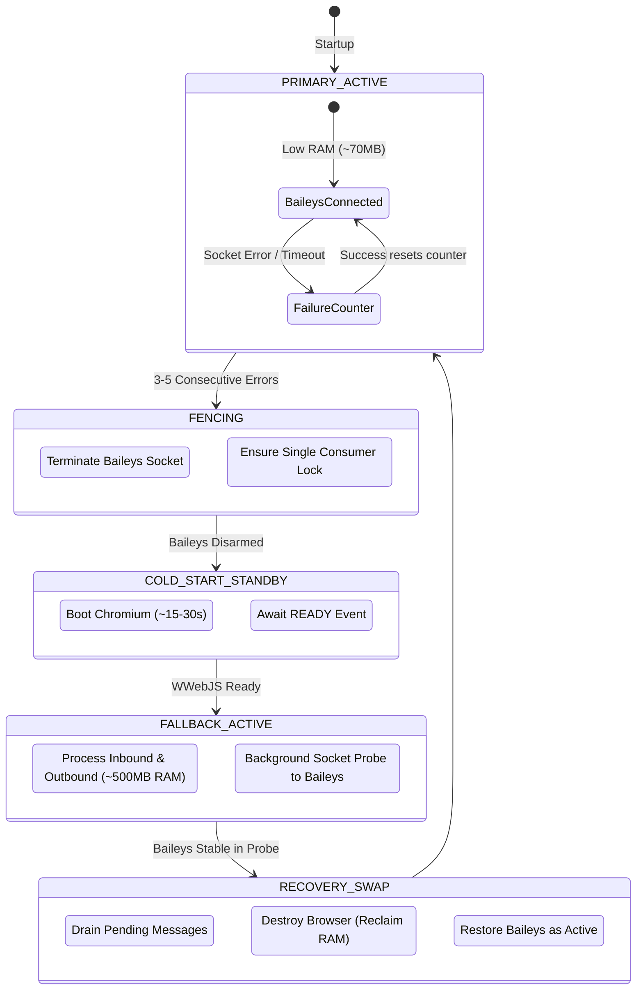

# baileys-wwebjs-failover

**[English](README.md)** | **[Português (Brasil)](README.pt-br.md)**

[]()
[](LICENSE)
[]()
[]()

---

## Overview

`baileys-wwebjs-failover` is a high-availability, resource-optimized WhatsApp gateway and failover orchestrator. It runs **Baileys** (WebSocket via Protobufs) as the primary engine for high speed and minimal memory footprint (~50–100 MB RAM), and automatically falls back to **whatsapp-web.js** (Puppeteer / Chromium) when repeated connection errors occur, avoiding total service downtime during WhatsApp protocol shifts.

## Architecture



### Key Capabilities

- **Resource Efficiency:** Runs without Chromium 90%+ of the time, saving 400–800 MB RAM per instance.
- **Circuit Breaker & Fencing:** Strictly terminates the failing primary engine before promoting fallback, avoiding split-brain message delivery.
- **Anti-Fingerprinting Standby Keep-Alive:** Periodic maintenance wakes WWebJS with randomized jitter (every 3–5 days) and dynamic text to prevent WhatsApp multi-device idle logouts.
- **Inbound Deduplication:** Atomic Redis deduplication guarantees at-most-once processing during failover transitions.

## Quickstart

```bash
# Clone the repository
git clone https://github.com/yegear1/baileys-wwebjs-failover.git
cd baileys-wwebjs-failover

# Install dependencies
pnpm install

# Copy environment variables
cp .env.example .env
```

## Configuration

| Variable | Description | Default | Required |
| :--- | :--- | :--- | :--- |
| `NODE_ENV` | Runtime environment mode | `development` | No |
| `PORT` | HTTP server port for `/health` and `/qr/*` | `3000` | No |
| `REDIS_URL` | Redis connection URL | `redis://127.0.0.1:6379` | Yes |
| `AUTH_DIR_BAILEYS` | Multi-device auth storage path for Baileys | `/data/auth/baileys` | No |
| `AUTH_DIR_WWEBJS` | Profile auth storage path for WWebJS | `/data/auth/wwebjs` | No |
| `FAILOVER_ERROR_THRESHOLD` | Consecutive errors before triggering failover | `3` | No |
| `PROBE_STABILITY_WINDOW_SEC` | Seconds Baileys must remain stable before failback | `300` | No |
| `KEEPALIVE_INTERVAL_DAYS_MIN` | Minimum days between standby keep-alive pings | `3` | No |
| `KEEPALIVE_INTERVAL_DAYS_MAX` | Maximum days between standby keep-alive pings | `5` | No |

## Development

```bash
pnpm install          # Install dependencies
pnpm test             # Run test suite
pnpm lint             # Run linter and formatting checks
pnpm typecheck        # Strict TypeScript type check
pnpm build            # Build project for production
```

## License

Released under the [MIT License](LICENSE).
