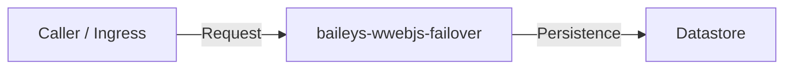

# baileys-wwebjs-failover

**[English](README.md)** | **[Português (Brasil)](README.pt-br.md)**

[]()
[](LICENSE)

---

## Overview

Core service and domain implementation for `baileys-wwebjs-failover`. Populate this section during Task `[00.1]` following the `readme-standard` skill.

## Architecture



## Quickstart

```bash
cp .env.example .env
```

## Configuration

| Variable | Description | Default | Required |
| :--- | :--- | :--- | :--- |
| `NODE_ENV` | Runtime environment mode | `development` | No |

## Usage

Document primary CLI commands, HTTP endpoints, or SDK calls here during Task `[00.1]`.

## Development

```bash
# Populate exact test, lint, and typecheck commands during Task [00.1]
```

## License

Released under the [MIT License](LICENSE).
