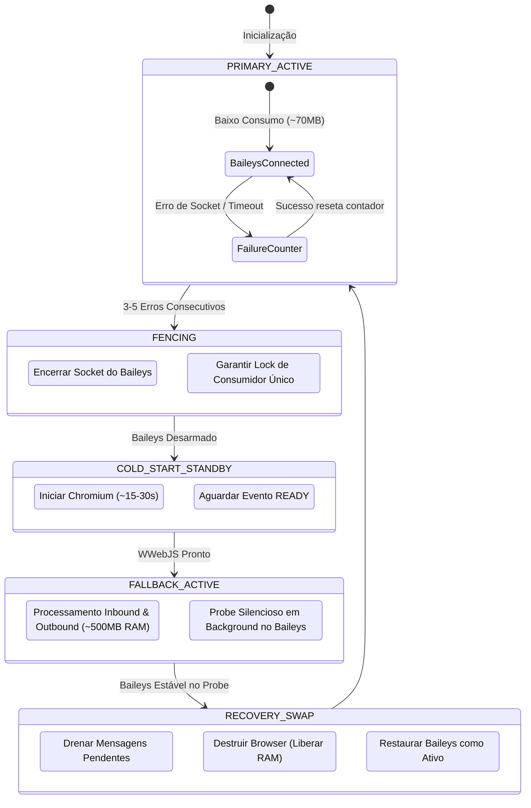

# baileys-wwebjs-failover

**[English](README.md)** | **[Português (Brasil)](README.pt-br.md)**

[]()
[](LICENSE)
[]()
[]()

---

## Visão Geral

O `baileys-wwebjs-failover` é um gateway de WhatsApp de alta disponibilidade e otimização de recursos. Ele utiliza o **Baileys** (WebSocket direto via Protobufs) como motor primário para máxima velocidade e consumo mínimo de memória (~50–100 MB de RAM), e executa failover automático para o **whatsapp-web.js** (Puppeteer / Chromium) quando ocorrem erros consecutivos de conexão, evitando a perda total do serviço em atualizações de protocolo do WhatsApp.

## Arquitetura



### Principais Capacidades

- **Eficiência de Recursos:** Opera sem navegador Chromium durante 90%+ do tempo, economizando 400–800 MB de RAM por instância.
- **Circuit Breaker & Fencing:** Desconecta e desarma forçadamente o motor falho antes de promover o secundário, eliminando duplicidade de mensagens (split-brain).
- **Keep-Alive Anti-Fingerprint em Standby:** Rotina de manutenção que acorda o WWebJS com variação aleatória de intervalo (3 a 5 dias) e mensagens dinâmicas para evitar a desvinculação da sessão pelo WhatsApp.
- **Desduplicação Atômica:** Filtro atômico no Redis garante processamento *at-most-once* durante janelas de transição entre motores.
- **Prevenção Determinística de Socket Hang:** Aplica timeout configurável de 15s (`SEND_MESSAGE_TIMEOUT_MS`) nos envios do Baileys para evitar travamentos silenciosos.
- **Guarda de Conectividade WAN do Host:** Valida conectividade de internet antes de iniciar o failover, evitando inicialização desnecessária do Chromium durante quedas de WAN.
- **Fila Zero-Loss e Dead-Letter Queue (DLQ):** Reenfileira automaticamente mensagens com falha transitória e direciona mensagens esgotadas ou malformadas para `whatsapp:send:dlq`.

## Início Rápido

```bash
# Clonar o repositório
git clone https://github.com/yegear1/baileys-wwebjs-failover.git
cd baileys-wwebjs-failover

# Instalar dependências
pnpm install

# Configurar variáveis de ambiente
cp .env.example .env
```

## Configuração

| Variável | Descrição | Padrão | Obrigatório |
| :--- | :--- | :--- | :--- |
| `NODE_ENV` | Modo do ambiente de execução | `development` | Não |
| `PORT` | Porta HTTP para `/health`, `/metrics` e `/qr/*` | `3000` | Não |
| `REDIS_URL` | URL de conexão com o Redis | `redis://127.0.0.1:6379` | Sim |
| `REDIS_PORT` | Porta em loopback no host mapeada pelo Compose para o Redis | `6379` | Não |
| `AUTH_DIR_BAILEYS` | Diretório de armazenamento das credenciais do Baileys | `/data/auth/baileys` | Não |
| `AUTH_DIR_WWEBJS` | Diretório de armazenamento do perfil do WWebJS | `/data/auth/wwebjs` | Não |
| `PUPPETEER_EXECUTABLE_PATH` | Caminho do executável do Chromium | `/usr/bin/chromium` | Não |
| `FAILOVER_ERROR_THRESHOLD` | Quantidade de erros consecutivos antes do failover | `3` | Não |
| `PROBE_STABILITY_WINDOW_SEC` | Segundos de estabilidade exigidos do Baileys para failback | `300` | Não |
| `ENABLE_HOST_CONNECTIVITY_GUARD` | Verifica conectividade WAN do host antes de executar o failover | `true` | Não |
| `SEND_MESSAGE_TIMEOUT_MS` | Timeout em ms para operações de envio no Baileys | `15000` | Não |
| `MAX_SEND_RETRIES` | Limite de tentativas para mensagens com falha de envio | `3` | Não |
| `DLQ_QUEUE_KEY` | Chave da fila Redis para mensagens de saída esgotadas/malformadas | `whatsapp:send:dlq` | Não |
| `KEEPALIVE_INTERVAL_DAYS_MIN` | Intervalo mínimo (em dias) entre pings de manutenção | `3` | Não |
| `KEEPALIVE_INTERVAL_DAYS_MAX` | Intervalo máximo (em dias) entre pings de manutenção | `5` | Não |
| `INBOX_QUEUE_KEY` | Chave da fila Redis para mensagens de entrada normalizadas | `whatsapp:receive:inbox` | Não |
| `OUTBOUND_QUEUE_KEY` | Chave da fila prioritária Redis para mensagens de saída | `whatsapp:send:priority` | Não |
| `FENCING_LOCK_KEY` | Chave do lock distribuído de fencing no Redis | `gateway:active_engine` | Não |
| `BLPOP_TIMEOUT_SECONDS` | Timeout bloqueante (segundos) na fila Redis de saída | `2` | Não |
| `SHUTDOWN_TIMEOUT_MS` | Timeout em milissegundos para encerramento gracioso | `10000` | Não |

## Implantação com Docker

O gateway inclui um Dockerfile multi-stage e uma especificação do Docker Compose de produção com higiene estrita para Chromium (`init: true`, `shm_size: 2gb`, execução como usuário não-root e volumes segregados para armazenamento de autenticação).

```bash
# Preparar arquivo de variáveis de ambiente
cp .env.example .env

# Validar integridade da configuração do compose
docker compose -f docker-compose.yml --env-file .env.example config --quiet

# Iniciar serviços do redis e gateway em background
docker compose up -d

# Inspecionar saúde, motor ativo e métricas Prometheus
curl -s http://127.0.0.1:3000/health
curl -s http://127.0.0.1:3000/metrics

# Acompanhar logs do gateway
docker compose logs -f gateway
```

## Desenvolvimento

```bash
pnpm install          # Instalar dependências
pnpm test             # Executar suite de testes
pnpm lint             # Executar verificações de linter e formatação
pnpm typecheck        # Checagem estrita de tipos TypeScript
pnpm build            # Compilar projeto para produção
```

## Licença

Distribuído sob a licença [MIT](LICENSE).
