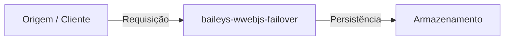

# baileys-wwebjs-failover

**[English](README.md)** | **[Português (Brasil)](README.pt-br.md)**

[]()
[](LICENSE)

---

## Visão Geral

Implementação principal e domínio do projeto `baileys-wwebjs-failover`. Preencha esta seção durante a Task `[00.1]` seguindo a skill `readme-standard`.

## Arquitetura



## Início Rápido

```bash
cp .env.example .env
```

## Configuração

| Variável | Descrição | Padrão | Obrigatório |
| :--- | :--- | :--- | :--- |
| `NODE_ENV` | Modo do ambiente de execução | `development` | Não |

## Uso

Documente os principais comandos de CLI, endpoints HTTP ou chamadas de SDK durante a Task `[00.1]`.

## Desenvolvimento

```bash
# Preencha os comandos exatos de teste, lint e typecheck durante a Task [00.1]
```

## Licença

Distribuído sob a licença [MIT](LICENSE).
